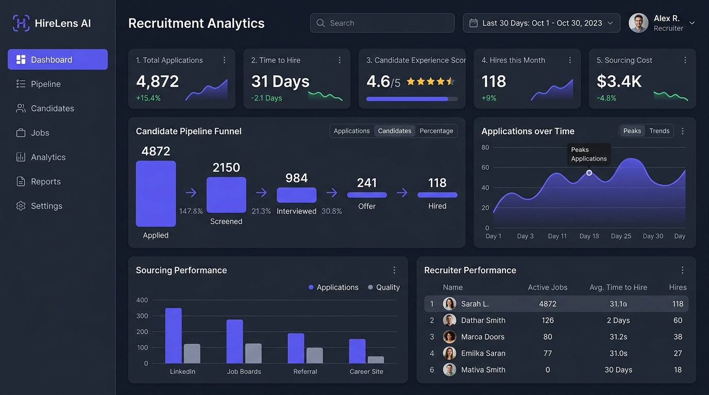
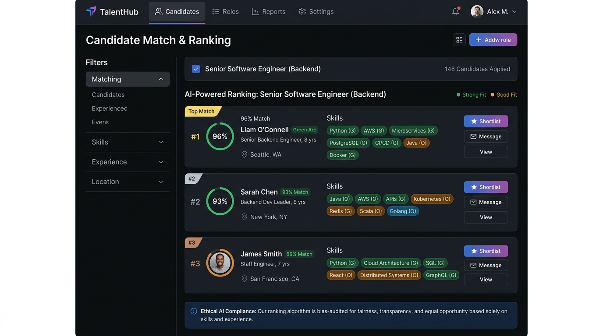

# HireLens AI — Intelligent Recruitment & Applicant Tracking System



> **Enterprise-Grade AI-Powered Applicant Tracking System & Talent Intelligence Platform.**  
> Built for modern talent acquisition teams to streamline resume parsing, multi-factor candidate ranking, interactive Kanban pipelines, and interview scheduling without reliance on paid proprietary AI APIs.

---

## Author & Project Metadata

- **Author**: Afreen Fasiha
- **Project**: HireLens AI
- **Category**: AI-Powered Recruitment & ATS Platform
- **Purpose**: CodeC Technologies Internship Project
- **Repository URL**: https://github.com/AfreenFasiha/HireLensAI
- **Live Demo URL**: `[Live Demo URL - To be provided]`

---

## 1. Problem Statement & Objectives

### The Problem
Traditional recruitment platforms suffer from disjointed workflows, brittle keyword-based resume filters that overlook qualified talent, opaque "black-box" ranking algorithms that risk algorithmic bias, and fragmented scheduling tools.

### Objectives
1. **Explainable AI Matching**: Provide transparent, multi-dimensional candidate-to-job matching scores with granular textual breakdowns and human-in-the-loop review.
2. **Automated Document Intelligence**: Extract structured contact details and normalized technical skills from PDF and DOCX documents using open-source NLP without external paid APIs.
3. **Streamlined Pipeline Operations**: Provide an interactive Kanban board persisting across sessions, conflict-free interview calendar coordination, and real-time recruitment analytics computed from actual relational database records.
4. **Enterprise Multi-Tenant Security**: Enforce role-based access control (Admin, Recruiter, Hiring Manager), Argon2 password hashing, short-lived JWT access tokens with rotating refresh cookies, and organization-scoped data isolation.

---

## 2. Key Features

- **Intuitive SaaS Dashboard**: Real-time KPI metrics, application timeline area charts, stage distribution breakdowns, and upcoming interview widgets.
- **AI Resume Parser**: Text extraction from PDF (PyMuPDF) and DOCX (python-docx) files, regex contact extraction, and skill normalization against an extensive taxonomy.
- **Candidate Verification Step**: Recruiter review modal allowing human verification and correction of parsed fields before committing to database records.
- **Explainable Multi-Factor Candidate Ranking**:
  - Required Skills Coverage: **40%**
  - Semantic Description Similarity: **30%** (Scikit-Learn TF-IDF + Cosine Similarity)
  - Preferred Skills Coverage: **15%**
  - Experience Alignment: **15%** (Logarithmic curve)
  - Configurable weights per job requisition.
- **Interactive Kanban Pipeline**: Drag-and-drop candidates across 6 hiring stages (`Applied` → `Screening` → `Shortlisted` → `Interview` → `Offer` → `Hired`) with an immutable transition audit trail.
- **Interview Scheduling & Calendar**: Timezone-aware scheduling, meeting link generation, interviewer calendar conflict prevention, and structured rating scorecards (1-5 stars, recommendations).
- **Recruitment Analytics**: Recharts visualizations for time-to-hire, funnel conversion rates, applications by job, and skill match histograms with CSV dataset export.
- **Role-Based Admin Console**: Organization user management, role escalation prevention, and system audit logs.
- **Dark & Light Interface**: Modern slate and indigo palette with seamless instant theme toggling.

---

## 3. Technology Stack

### Frontend
- **Framework**: React 19 with Vite & TypeScript
- **Styling**: Tailwind CSS with CSS custom properties (dark/light themes)
- **State Management & Caching**: TanStack React Query
- **Routing**: React Router DOM v7
- **Data Visualization**: Recharts
- **Icons**: Lucide React
- **Forms & Validation**: React Hook Form, Zod

### Backend
- **Framework**: Python 3.9+ / 3.11+, FastAPI
- **Data Modeling & ORM**: SQLAlchemy 2.0
- **Database Migrations**: Alembic
- **Serialization & Validation**: Pydantic v2 & Pydantic-Settings
- **Authentication**: JWT (PyJWT) with Argon2 password hashing (`argon2-cffi`)
- **HTTP Engine**: Uvicorn & HTTPX

### AI & NLP Subsystem
- **PDF Extraction**: PyMuPDF (`fitz`)
- **DOCX Extraction**: `python-docx`
- **Text & Semantic Similarity**: Scikit-Learn TF-IDF Vectorizer & Cosine Similarity
- **Skill Normalization**: Configurable taxonomy dictionary with canonical alias resolution

### Database & DevOps
- **Primary Database**: PostgreSQL (Production & Docker) / Dual zero-config SQLite WAL fallback
- **Containerization**: Docker & Docker Compose
- **Deployment Targets**: Vercel (Frontend), Render / Railway (Backend), Managed PostgreSQL

---

## 4. Visual Showcase

| Analytics Dashboard Overview | Candidate Match & Explainable Ranking |
| :---: | :---: |
|  |  |

---

## 5. System Architecture

```
+-------------------------------------------------------------------------+
|                              CLIENT LAYER                               |
|        React 19 + TypeScript + Vite + Tailwind CSS + Recharts           |
+-------------------------------------------------------------------------+
                                     |
                                     | HTTPS / JSON / JWT
                                     v
+-------------------------------------------------------------------------+
|                               API GATEWAY                               |
|          FastAPI v0.128 + Uvicorn + CORS Middleware + Audit Log         |
+-------------------------------------------------------------------------+
       |                             |                           |
       v                             v                           v
+---------------+            +---------------+           +---------------+
| CORE SERVICES |            | AI / NLP CORE |           | SECURITY CORE |
| Jobs          |            | PyMuPDF / docx|           | Argon2 Hasher |
| Candidates    |            | Skill Taxonomy|           | JWT Bearer    |
| Pipeline      |            | TF-IDF Sim.   |           | RBAC Enforcer |
| Interviews    |            | Match Scorer  |           | Refresh Sess. |
| Analytics     |            | Rule Engine   |           | Org Scoping   |
+---------------+            +---------------+           +---------------+
       \                             |                          /
        \                            |                         /
         v                           v                        v
+-------------------------------------------------------------------------+
|                            PERSISTENCE LAYER                            |
|             SQLAlchemy 2.0 ORM + Alembic Migration Manager              |
|        PostgreSQL (Production) / SQLite WAL Mode (Local Fast Dev)       |
+-------------------------------------------------------------------------+
```

---

## 6. Local Quick Start Guide

### Prerequisites
- Python 3.9 or higher
- Node.js v18 or higher (Node 20+ recommended)
- (Optional) Docker & Docker Compose for PostgreSQL

### Step 1: Clone the Repository
```bash
git clone https://github.com/AfreenFasiha/HireLensAI.git hirelens-ai
cd hirelens-ai
```

### Step 2: Backend Setup
```bash
cd backend
python3 -m venv venv
source venv/bin/activate  # On Windows: venv\Scripts\activate
pip install --upgrade pip
pip install -r requirements.txt

# Run migrations
alembic stamp head

# Seed comprehensive demo organization, jobs, and candidates
python -m app.database.seed_data

# Start FastAPI Server (running on http://localhost:8000)
uvicorn app.main:app --host 0.0.0.0 --port 8000 --reload
```

### Step 3: Frontend Setup
In a new terminal window:
```bash
cd frontend
npm install --legacy-peer-deps

# Start Vite Development Server (running on http://localhost:5173)
npm run dev
```

### Step 4: Access the Application
- **Frontend Dashboard**: [http://localhost:5173](http://localhost:5173)
- **Backend API**: [http://localhost:8000](http://localhost:8000)
- **Interactive Swagger Docs**: [http://localhost:8000/docs](http://localhost:8000/docs)
- **Health Check**: [http://localhost:8000/health](http://localhost:8000/health)

---

## 7. Demo Credentials (Local Development)

The seed script initializes the fictional organization **TechNova Solutions** with the following accounts:

| Role | Email | Password | Permissions |
| :--- | :--- | :--- | :--- |
| **Administrator** | `admin@technova.io` | `Password123!` | Full control, role assignment, audit logs, settings |
| **Senior Recruiter** | `sarah.recruiter@technova.io` | `Password123!` | Job CRUD, candidate management, resume parsing, ranking |
| **Tech Recruiter** | `marcus.talent@technova.io` | `Password123!` | Candidate sourcing, pipeline transitions, interviews |
| **Hiring Manager** | `elena.engineering@technova.io` | `Password123!` | Candidate review, interview feedback, rating scorecards |

*Quick-fill demo buttons are embedded directly on the login screen for one-click access.*

---

## 8. Automated Testing

### Backend Unit & Integration Tests (Pytest)
```bash
cd backend
PYTHONPATH=. venv/bin/pytest tests/
```

### End-to-End Workflow Verification Script
Validates user authentication, job creation, resume ingestion, AI matching, candidate ranking, Kanban stage progression, and interview scheduling against the running server:
```bash
cd backend
venv/bin/python tests/e2e_verification.py
```

### Frontend Build & Typecheck
```bash
cd frontend
npm run build
```

---

## 9. Docker Deployment

To launch the complete containerized stack (PostgreSQL, FastAPI, and Nginx React):
```bash
docker compose up -d --build
```
This automatically boots:
- PostgreSQL on port `5432` with volume persistence
- FastAPI backend on port `8000`
- React production bundle on port `5173`

---

## 10. AI Candidate Matching Methodology & Ethics

### Matching Formula
The overall match score $S$ is a weighted sum normalized to $0 - 100\%$:
$$S = w_{req} \cdot S_{req} + w_{sem} \cdot S_{sem} + w_{pref} \cdot S_{pref} + w_{exp} \cdot S_{exp}$$
- $S_{req}$: Mandatory skills overlap ratio against normalized taxonomy.
- $S_{sem}$: TF-IDF n-gram cosine similarity comparing resume body to job description.
- $S_{pref}$: Bonus coverage for preferred technical competencies.
- $S_{exp}$: Experience alignment calculated via a smooth logarithmic curve:
  $$S_{exp} = 100 \cdot \frac{1 - e^{-2.5 \cdot (Y_{cand} / Y_{req})}}{1 - e^{-2.5}}$$

### Ethical AI Guardrails
1. **Protected Characteristics Stripped**: Age, gender, ethnicity, religion, disability, photos, and personal addresses are explicitly excluded from model inputs.
2. **Transparent Rationale**: Every score is accompanied by an explainable natural language rationale detailing matched and missing skills.
3. **Advisory Decision Support**: AI outputs are framed strictly as human-in-the-loop assistance. The system prohibits automated rejection or autonomous hiring determinations.

---

## 11. Project Folder Structure

```
hirelens-ai/
├── backend/
│   ├── alembic/              # Database migration versions
│   ├── app/
│   │   ├── api/v1/           # Versioned REST route controllers
│   │   ├── core/             # Config, security, JWT, Argon2
│   │   ├── models/           # SQLAlchemy 2.0 relational models
│   │   ├── schemas/          # Pydantic v2 validation models
│   │   ├── ai/               # Resume parsing & matching engine
│   │   └── database/         # Session management & seed data
│   ├── tests/                # Automated pytest and E2E verification
│   ├── requirements.txt      # Pinned Python dependencies
│   └── Dockerfile            # Production container configuration
├── frontend/
│   ├── src/
│   │   ├── components/       # Metric cards, badges, modals
│   │   ├── contexts/         # AuthContext and ThemeContext
│   │   ├── layouts/          # AppLayout and ProtectedRoute
│   │   ├── pages/            # Dashboard, Jobs, Rankings, Pipeline...
│   │   ├── services/         # Axios API client
│   │   └── types/            # TypeScript interfaces
│   ├── package.json
│   ├── vite.config.ts
│   └── tailwind.config.js
├── docs/
│   ├── architecture.md       # Layered system architecture
│   ├── database-schema.md    # Mermaid ER diagram & specifications
│   ├── api-documentation.md  # Versioned REST API reference
│   ├── deployment.md         # Production cloud deployment guide
│   └── screenshots/          # High-resolution platform preview assets
├── docker-compose.yml        # Multi-container orchestration
├── .env.example              # Environment variables template
├── .gitignore
├── LICENSE                   # MIT License
└── README.md
```

---

## 12. Deployment Summary

- **Frontend**: Deployable to [Vercel](https://vercel.com) via `npm run build` and `frontend/vercel.json` rewrite rules.
- **Backend**: Deployable to [Render](https://render.com) or Railway with Python 3 environment and `alembic upgrade head`.
- **Database**: Managed PostgreSQL on Neon, Supabase, Render, or AWS RDS.
- Full step-by-step instructions available in [docs/deployment.md](docs/deployment.md).

---

## 13. License

Distributed under the MIT License. See [LICENSE](LICENSE) for details.
