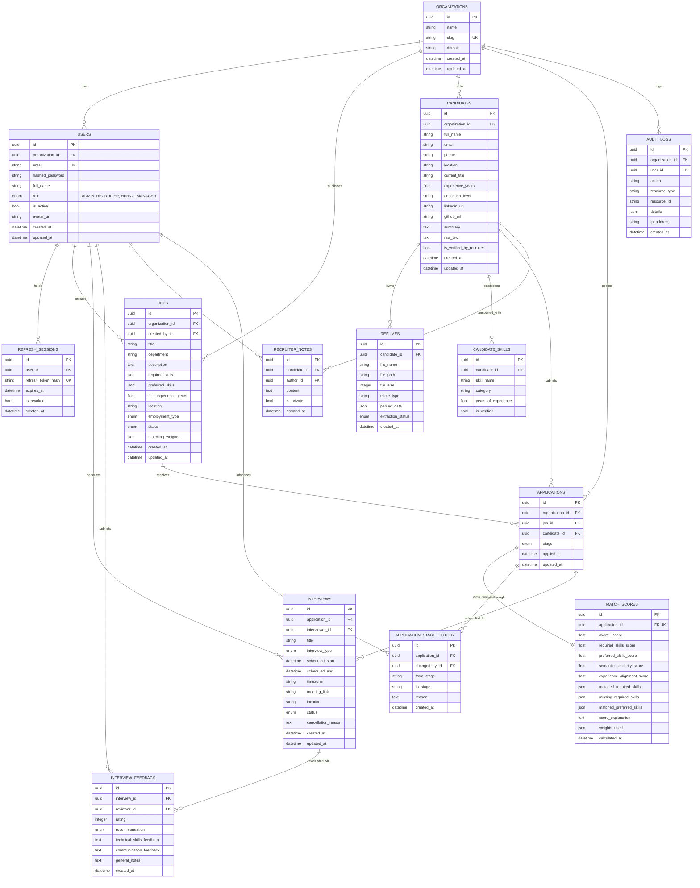

# HireLens AI — Database Schema & Entity Relationship Diagram

## 1. Entity Relationship (ER) Diagram

---

## 2. Table Specifications & Indexes

| Table | Primary Key | Foreign Keys | Key Indexes & Constraints |
| :--- | :--- | :--- | :--- |
| `organizations` | `id (UUID)` | None | `slug (UNIQUE)` |
| `users` | `id (UUID)` | `organization_id -> organizations.id` | `email (UNIQUE)`, `role` |
| `refresh_sessions` | `id (UUID)` | `user_id -> users.id` | `refresh_token_hash (UNIQUE, INDEX)` |
| `jobs` | `id (UUID)` | `organization_id`, `created_by_id` | `status`, `department`, `created_at` |
| `candidates` | `id (UUID)` | `organization_id` | `email (INDEX)`, `full_name (INDEX)` |
| `resumes` | `id (UUID)` | `candidate_id -> candidates.id` | `candidate_id`, `extraction_status` |
| `candidate_skills` | `id (UUID)` | `candidate_id -> candidates.id` | `skill_name (INDEX)`, `candidate_id` |
| `applications` | `id (UUID)` | `organization_id`, `job_id`, `candidate_id` | `UNIQUE(job_id, candidate_id)`, `stage` |
| `application_stage_history` | `id (UUID)` | `application_id`, `changed_by_id` | `application_id`, `created_at` |
| `match_scores` | `id (UUID)` | `application_id -> applications.id` | `application_id (UNIQUE)`, `overall_score` |
| `interviews` | `id (UUID)` | `application_id`, `interviewer_id` | `interviewer_id`, `scheduled_start`, `status` |
| `interview_feedback` | `id (UUID)` | `interview_id`, `reviewer_id` | `interview_id` |
| `recruiter_notes` | `id (UUID)` | `candidate_id`, `author_id` | `candidate_id` |
| `audit_logs` | `id (UUID)` | `organization_id`, `user_id` | `organization_id`, `action`, `created_at` |
